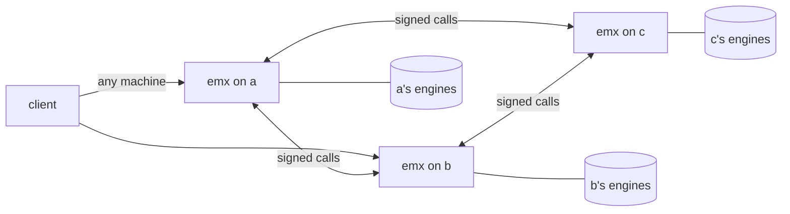

# Mesh: several machines, one endpoint

[← README](../README.md) · [Documentation index](../README.md#documentation)

A mesh joins the gateways of several machines. A client can send any request
to any of them; it is served by whichever machine has the model, and started
there if it is stopped. `GET /v1/models` on any machine lists the models of
all of them.



## Setup

On every machine:

1. Put the same secret in a file only you can read:

   ```sh
   openssl rand -hex 32 > ~/.config/emx/mesh.secret   # once; copy the file to the others
   chmod 600 ~/.config/emx/mesh.secret
   ```

2. Add a `mesh` block to `config.yaml`, naming this machine and the others:

   ```yaml
   gateway:
     host: 0.0.0.0
     tls: {cert: /etc/emx/box1.pem, key: /etc/emx/box1-key.pem}
   mesh:
     node: box1                      # this machine's name
     secret_file: mesh.secret        # relative to the config directory
     keys_from: box1                 # the machine that holds keys, teams, prices and aliases
     peers:
       - {name: box2, url: https://box2.lan:7777}
       - {name: box3, url: https://box3.lan:7777}
     # ca_file: /etc/emx/ca.pem      # trust a private CA for the peers' certificates
     # interval: 5s                  # how often each peer is asked what it serves
   ```

3. Register on each machine the models it runs (`emx model add`), and start
   `emx serve`.

`emx mesh` (or `GET /emx/v1/mesh`, admin or auditor) shows which machines
answer, how fast, and what each serves:

```text
this machine: box2; keys, teams, prices and aliases: copied from box1

NODE  STATUS        RTT  VERSION  MODELS
box2  this machine  -    v0.2.0   qwen3.8-27b-q4
box1  up            1ms  v0.2.0   flash-next-iq3s
box3  up            2ms  v0.2.0   qwen3-0.6b-q8, qwen3.8-27b-q4
```

### Certificates on a home or office network

Without certificates from a public CA, make a private one and a
certificate for each machine (its address in `subjectAltName`), then point
`mesh.ca_file` at `ca.pem` on every machine:

```sh
openssl req -x509 -newkey ec -pkeyopt ec_paramgen_curve:prime256v1 -nodes -days 825 \
  -keyout ca-key.pem -out ca.pem -subj "/CN=emx mesh CA" \
  -addext basicConstraints=critical,CA:TRUE -addext keyUsage=critical,keyCertSign,cRLSign
for m in box1:192.168.1.10 box2:192.168.1.11; do
  n=${m%%:*}; ip=${m##*:}
  openssl req -newkey ec -pkeyopt ec_paramgen_curve:prime256v1 -nodes -keyout $n-key.pem -out $n.csr -subj "/CN=$n"
  openssl x509 -req -in $n.csr -CA ca.pem -CAkey ca-key.pem -CAcreateserial -days 825 -out $n.pem \
    -extfile <(printf "subjectAltName=IP:%s,DNS:%s\nkeyUsage=critical,digitalSignature\nextendedKeyUsage=serverAuth,clientAuth\n" $ip $n)
done
```

The `keyUsage` lines matter to clients: Python 3.13 and later refuse a CA
without them. Clients of the mesh trust `ca.pem` too.

## Routing

For each request, the machine it entered chooses, in this order:

1. **Itself**, when it has the model ready and no other machine has it ready
   with fewer requests per slot.
2. **Another machine that has the model ready**, the least busy first
   (requests running and waiting, per slot the engine has).
3. **Itself**, when it has the model registered and can start it.
4. **Another machine that can start it.** That machine starts the model.

A model that runs on several machines is spread over them as they get busy.
A model this machine can start is not started while another machine has it
ready: start it yourself (`emx run`) to add capacity. If a machine cannot
be reached, the request goes to the next one, and the machine is left out
until it answers again.

A forwarded request is served where it arrives and never forwarded again.
The response carries `X-Emx-Node` (the machine that served it) and
`X-Emx-Instance` as `node/instance`.

## Keys, teams, prices and aliases

One machine holds them (`mesh.keys_from`). Make every change to keys,
teams, prices and aliases there, with the CLI, the settings API or the admin
UI. The other machines copy them every `interval`. They refuse changes of
their own with a `conflict` error (409) naming the machine to use. Each
machine keeps its own `models.yaml`, engines and other settings.

Only key hashes are copied, never secrets. A follower stores the copy in
`keys.yaml` and `mesh-shared.yaml`. If the machine that holds the keys is
down, the others keep using their last copy.

## Limits and records

The machine a request enters checks the client's key, its model access and
the key's and team's limits, and meters the tokens. Daily token quotas and
team budgets count what the key and team used on every machine. Each machine
learns the others' totals every `interval`, so a burst on several machines
at once can overshoot a limit by what was used in the meantime. Requests per
minute (`rpm`) are counted on each machine separately.

Both machines record a forwarded request:

| Machine | Record |
| --- | --- |
| where it entered | `node` is the machine that served it; tokens, cost and latency as the client saw them; counts against limits |
| where it was served | `mesh_from` is the machine that forwarded it; same client and team; does not count against limits there |

`emx usage --by node` splits a machine's traffic by where it was served.

## Security

- Every call between machines (model lists, key copies, forwarded
  requests) is signed with HMAC-SHA256 under the mesh secret. The signature
  covers method, path, time, sender, the client and team, and the body. A
  receiver refuses a call from a machine that is not in its `peers`, a call
  more than 60 seconds from its own clock, and a call it has already seen.
  Answers that carry state are signed too, bound to the call.
- A client cannot pose as a peer. Requests with `X-Emx-Mesh-*` headers are
  verified as mesh calls, and a gateway removes such headers from what it
  forwards before signing its own.
- The secret never travels. Prompts and outputs do: use HTTPS between the
  machines (`gateway.tls` on each, `https://` peer URLs). `emx doctor` warns
  about plain HTTP. When a peer requires client certificates
  (`gateway.tls.client_ca`), each machine presents its own `gateway.tls`
  certificate.
- Keep the clocks in sync (NTP); calls more than 60 seconds off are refused.

## Not covered

- Management and observability (`ps`, `usage`, `requests`, `events`) are per
  machine. Ask each machine, or use its API.
- Models are started and stopped by the machine that has them.
  `emx run`, `stop` and `ensure` act on the local machine.
